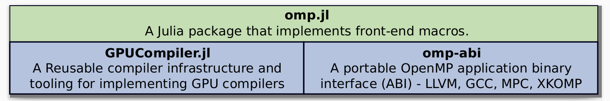

# OMP.jl - OpenMP APIs in Julia

The OMP.jl package provides OpenMP APIs in Julia.
It builds upon [GPUCompiler.jl](https://github.com/JuliaGPU/GPUCompiler.jl) and [omp-abi](https://github.com/Julia-OpenMP/omp-abi).

[](docs/figures/omp-jl.pdf)

# Installation
OMP.jl and its binary dependency, `OMPABI_jll`, are distributed through the
[Julia-OpenMP registry](https://github.com/Julia-OpenMP/Registry):
```julia
pkg> registry add https://github.com/Julia-OpenMP/Registry
pkg> add OMP
```
No compiler or system OpenMP runtime is needed: omp-abi comes prebuilt as an
artifact (Linux only for now), and the OpenMP runtime is the `libgomp` shipped with Julia.

## Selecting the OpenMP runtime
omp-abi is built with all its backends (`-DUSE_DYNAMIC=ON`), and forwards to the
OpenMP runtime selected at run time: by default the `libgomp` shipped with Julia.
See [omp-abi](https://github.com/Julia-OpenMP/omp-abi) for how to select another runtime.

# Directives
OpenMP directives are written as in C/C++/Fortran, in a string, followed by their associated
code (block, loop, function definition) if any:
```julia
using OMP

@pragma "omp parallel num_threads(4) default(shared)" begin
    ...
end

@pragma "omp parallel for reduction(+: s) schedule(dynamic, 4) if(n > 1000)" for i in eachindex(x)
    s += x[i]^2
end

@pragma "omp task depend(in: a) depend(out: b) firstprivate(n)" begin
    ...
end

@pragma "omp target teams distribute parallel for map(tofrom: x[1:n])" for i in 1:n
    ...
end

@pragma "omp barrier"
```
Expressions in clauses (`n > 1000`, `x[1:n]`) are Julia code referring to your variables;
`@omp "..."` is short for `@pragma "omp ..."`.

Directives that are valid Julia syntax may also be written without a string, e.g.
`@pragma omp task depend(in: a) begin ... end`. This is not possible with Julia keywords
(`for`, `do`, `if`, `begin`, `local`, ...): use a string for those. When Julia parses such a
directive anyway (`@pragma omp declare_target local(x)`, `@pragma omp parallel for i in 1:n`),
OMP.jl reports it and suggests the equivalent string; otherwise Julia itself reports a parse
error.

Directives are parsed and validated against the specification at macro expansion time
(unknown or misplaced clauses, invalid modifiers, mutually exclusive or repeated clauses,
missing required clauses, ...). Code generation is being implemented: directives that are
valid but not supported yet throw an `UnsupportedDirectiveError`. `OMP.Frontend.@pragma_ir`
shows how a directive is parsed.

# API routines
The OpenMP API of C's `omp.h` is exported by `OMP`, with the same names:
```julia
using OMP

omp_set_num_threads(4)
nthreads = omp_get_max_threads()          # or OMP.omp_get_max_threads()
t0 = omp_get_wtime()
omp_set_schedule(omp_sched_dynamic, 16)

lk = Ref{omp_lock_t}()
omp_init_lock(lk); omp_set_lock(lk); omp_unset_lock(lk); omp_destroy_lock(lk)

traits = [omp_alloctrait_t(omp_atk_alignment, 64)]
a = omp_init_allocator(omp_default_mem_space, length(traits), traits)
p = omp_alloc(1024, a); omp_free(p, a); omp_destroy_allocator(a)
```
It is omp-abi's OpenMP API, with portable types: there is nothing implementation defined
(the lock types, the values of `omp_default_mem_space` or `omp_atv_all`, ...), whatever the
OpenMP runtime, and omp-abi converts to the runtime's ABI. The bindings are the C interface:
OpenMP logicals are `Cint`s, `char *` arguments are `Cstring`s (pass a `String`, or a pointer
to a buffer), pointer arguments take a `Ref` or an array, and there are no default arguments.

The API follows the latest OpenMP specification: `OMP.has_routine(:omp_get_num_teams_dim)`
tells whether the runtime implements a routine. Calling one it does not implement aborts.

# Development

## Layout
| path        | content                                                                    |
|-------------|----------------------------------------------------------------------------|
| `src/`      | the `OMP` module                                                           |
| `src/frontend/` | the directive front-end (`OMP.Frontend`): parser, validation, macros   |
| `src/frontend/generated/` | the OpenMP directive syntax as data (`OMP.Frontend.Spec`), generated by omp-generator (`omp-to-jl.py`): do not edit |
| `lib/`      | C bindings of omp-abi (`OMP.LibOMPABI`), including the OpenMP API, generated: do not edit |
| `res/`      | binding generator (`res/wrap.jl`, Clang.jl)                                |
| `deps/`     | `build_local.jl`: build omp-abi from source and select it as a preference  |
| `test/`, `docs/`, `examples/` | each its own project, in the package [workspace](https://pkgdocs.julialang.org/v1/toml-files/#Workspaces) |
| `contrib/`   | release tooling: BinaryBuilder recipe of `OMPABI_jll`, registry ([how to release](contrib/README.md)) |

## Working on omp-abi
By default OMP.jl uses the omp-abi of `OMPABI_jll`.
```bash
# build a local omp-abi checkout instead, and use it from OMP.jl (`libompabi` in LocalPreferences.toml)
OMP_ABI_SOURCE_DIR=../omp-abi julia --project=deps deps/build_local.jl

# regenerate lib/LibOMPABI.jl after changing the omp-abi headers
julia --project=res res/wrap.jl
```

## Updating to a new OpenMP specification
Everything that derives from the OpenMP specification is generated by omp-generator
(`omp-to-jl.py`): the directive syntax, in OMP.jl, and the OpenMP API, in omp-abi:
```bash
# 1. from omp-to-jl.py/: regenerate OMP.jl's src/frontend/generated/ and omp-abi's API
python3 -m omp_generator --spec /path/to/OpenMP-spec --omp-jl ../OMP.jl --omp-abi ../omp-abi
# 2. from OMP.jl/: build that omp-abi, and regenerate its bindings (lib/LibOMPABI.jl)
OMP_ABI_SOURCE_DIR=../omp-abi julia --project=deps deps/build_local.jl
julia --project=res res/wrap.jl
```
`--check` (step 1) tells whether the generated files are up to date. If the specification
introduces something implementation defined, omp-abi does not compile until it is decided in
its `include/omp-abi/api-impl.h` (and converted by its backends, `src/backend/*/api.cc`).

## Working on the directive front-end
`src/frontend/Frontend.jl` describes its organization. Everything in `src/frontend/` is
hand-written, except `src/frontend/generated/`, which is generated from the (non-public)
OpenMP specification sources by omp-generator (`omp-to-jl.py`):
```bash
# regenerate src/frontend/generated/ after a change of the specification or of the generator
python3 -m omp_generator --spec /path/to/OpenMP-spec --omp-jl ../OMP.jl   # from omp-to-jl.py/
```
`src/frontend/schema.jl` defines the types that the generated code constructs: it is the
contract with the generator. How OpenMP is spelled in Julia (aliases, sugar, excluded
Fortran-only directives, known errata of the specification data) is decided in
`src/frontend/conventions.jl`. Code generation for a directive is added as a method of
`OMP.Frontend.lower` (`src/frontend/lower.jl`).

## Testing
```bash
julia --project -e 'using Pkg; Pkg.test()'
julia --project=examples examples/hello-from-abi.jl
```

# Support
If you are look for any support, feel free to contact us directly.    
Romain Pereira (rpereira@anl.gov)
